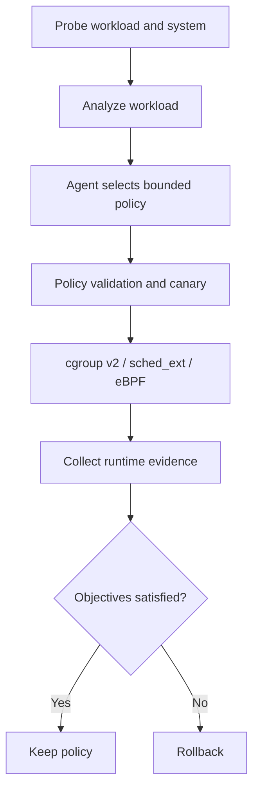

# SchedX-Agent

<p align="center">
  <strong>面向混合负载的 Linux 自适应资源调度 Agent</strong>
</p>

<p align="center">
  
  
  
  
</p>

SchedX-Agent 是一个面向 Linux 混合负载的自适应资源控制项目。系统采集工作负载与运行时指标，由 Agent 选择受约束的策略，再通过 **cgroup v2、sched_ext 与 eBPF** 执行、观测和验证；当策略未达到目标或触发安全条件时，支持回滚。

项目重点是探索 Agent 如何参与系统资源策略决策，同时让真正的调度与资源控制仍由 Linux 内核机制完成，而不是让 LLM 进入毫秒级调度路径。

## 工作流程



## 核心能力

- **工作负载识别：** 区分延迟敏感服务与后台批处理/干扰负载。
- **策略选择：** 根据分析结果选择 latency-first、background isolation、balanced 等受约束策略。
- **资源执行：** 使用 cgroup v2 控制资源权重，并在支持的内核上使用 sched_ext。
- **eBPF 观测：** 收集调度、资源与网络相关运行时证据。
- **Canary 与验证：** 先小范围应用，再根据服务指标和后台公平性检查结果。
- **自动回滚：** 验证失败时恢复先前资源配置并清理临时控制状态。
- **实验复现：** 保存原始压测输出、配置快照、汇总指标与报告。

## 当前验证平台

当前已验证平台为 **openEuler 24.03 LTS SP4**，使用 cgroup v2 和项目构建的 sched_ext-enabled 内核：

`6.6.0-159.4.3.154.oe2403sp4.schedx1`

发行版原生 SP4 内核未启用 `CONFIG_SCHED_CLASS_EXT`，因此在该内核上使用 cgroup-only fallback；只有启用 sched_ext 的内核才执行原生 sched_ext 路径。

## 快速开始

### 环境要求

- Linux；已验证 openEuler 24.03 LTS SP4
- Python 3.10+
- cgroup v2
- 如需原生 sched_ext：启用 `CONFIG_SCHED_CLASS_EXT` 的兼容内核
- 根据实验场景安装 nginx、redis、wrk、stress-ng 等工具

### 安装

```bash
python3 -m venv .venv
source .venv/bin/activate
pip install -e .
```

### 探测与分类

```bash
schedx status
schedx probe --top 10
schedx classify --top 50
```

### 先 dry-run，再执行变更

```bash
schedx optimize --target stress-ng --mode isolate_background --dry-run

# 确认目标主机、进程和策略后再执行
sudo schedx optimize --target stress-ng --mode isolate_background

# 恢复先前资源配置
sudo schedx rollback
```

> 资源控制命令可能真实修改 cgroup 或调度器状态。请先在可丢弃的虚拟机中测试，确认回滚路径可用，并避免直接在生产主机运行。

## 实验与结果

仓库包含 nginx、Redis、sysbench 和 scheduler comparison 等实验脚本及原始结果。已有报告覆盖吞吐、P95/P99 延迟、后台进度/公平性和重复试验置信区间。

README 不将不同内核、负载、实验轮次的数字合并成一个“通用提升率”。复现实验时应同时查看原始输出、实验配置和报告：

- [实验说明](docs/experiment.md)
- [系统设计](docs/design.md)
- [openEuler 环境准备](docs/openEuler_setup.md)
- [比赛证据矩阵](docs/competition_evidence_matrix.md)

## 仓库结构

```text
.
├── schedx/       # Agent 与策略编排
├── scx/          # sched_ext 相关实现
├── ebpf/         # eBPF 程序与观测
├── scripts/      # 安装、运行与实验脚本
├── kernel/       # 内核构建与配置材料
├── tests/        # 自动化与平台验证
├── results/      # 实验原始结果
├── reports/      # 实验报告
└── docs/         # 设计、环境与复现文档
```

## 竞赛材料

官方初赛材料与演示文件位于仓库的 `master` 分支根目录；源码与实验复现材料以当前 `main` 分支中的目录组织为准。第三方组件和代码来源说明见 [THIRD_PARTY_NOTICES.md](THIRD_PARTY_NOTICES.md) 与 [code_origin_stats.md](code_origin_stats.md)。

## 安全与限制

- Agent 只负责较慢时间尺度的策略选择；内核调度器负责实际任务调度。
- cgroup、sched_ext 与 eBPF 的可用能力依赖内核配置、权限和发行版环境。
- dry-run、canary、验证和 rollback 是操作流程的一部分，不应跳过。
- 本项目是研究与竞赛原型，不是通用生产级调度器。

## License

请以仓库中的 LICENSE 与第三方组件声明为准。
